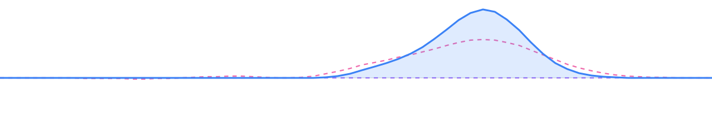
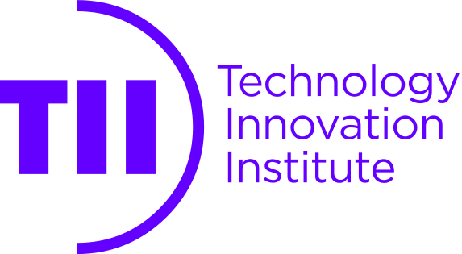
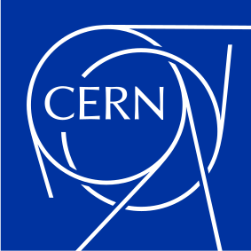
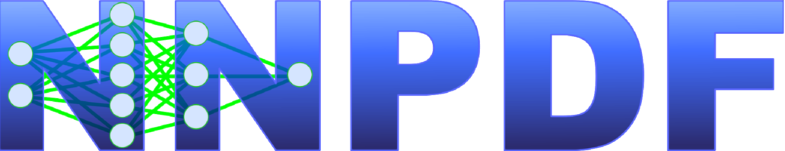
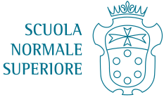

<!-- Generated by build.py from content/, edit there and rebuild. -->

# Hi, I'm Alessandro

I'm Alessandro Candido, a physicist and software developer, working in Quantum Computing.

<p align="center">
  
</p>

<p align="center">
  <a href="https://annibale.dev"></a>&nbsp;<a href="https://annibale.dev">Website</a>
  &emsp;&emsp;
  <a href="mailto:candido.ale@gmail.com"></a>&nbsp;<a href="mailto:candido.ale@gmail.com">Email</a>
  &emsp;&emsp;
  <a href="https://www.linkedin.com/in/alessandro-candido/"></a>&nbsp;<a href="https://www.linkedin.com/in/alessandro-candido/">LinkedIn</a>
  &emsp;&emsp;
  <a href="https://orcid.org/0000-0002-1405-3205"></a>&nbsp;<a href="https://orcid.org/0000-0002-1405-3205">ORCID</a>
  &emsp;&emsp;
  <a href="https://inspirehep.net/authors/1802044"></a>&nbsp;<a href="https://inspirehep.net/authors/1802044">INSPIRE</a>
</p>

```yaml
position: Senior Quantum Software Engineer
institution: Technology Innovation Institute, Quantum Research Centre
place: Abu Dhabi
start: 2025-10
collaboration: Qibo
focus: control and calibration of superconducting quantum processors
```

<p align="center">
  <a href="https://www.tii.ae/quantum"><picture><source media="(prefers-color-scheme: dark)" srcset="https://raw.githubusercontent.com/alecandido/alecandido/master/assets/logos/tii-dark.svg"></picture></a>
  &emsp;&emsp;
  <a href="https://qibo.science/"><picture><source media="(prefers-color-scheme: dark)" srcset="https://raw.githubusercontent.com/alecandido/alecandido/master/assets/logos/qibo-dark.svg"></picture></a>
</p>

<details>
  <summary><b>Experience</b></summary>

## Experience

```yaml
position: Research Fellow
institution: CERN, Theoretical Physics Department
place: Geneva
start: 2023-10
end: 2025-09
collaboration: Qibo
focus: core development of Qibo, within the CERN Quantum Technology Initiative
```

<p align="center">
  <a href="https://theory.cern/"></a>
  &emsp;&emsp;
  <a href="https://qibo.science/"><picture><source media="(prefers-color-scheme: dark)" srcset="https://raw.githubusercontent.com/alecandido/alecandido/master/assets/logos/qibo-dark.svg"></picture></a>
</p>

```yaml
position: Postdoctoral researcher (assegnista di ricerca)
institution: INFN, Milan section
place: Milan
start: 2023-04
end: 2023-10
supervisor: Stefano Forte
collaboration: NNPDF
focus: theory predictions for parton distribution functions
```

<p align="center">
  <a href="https://www.mi.infn.it/"><picture><source media="(prefers-color-scheme: dark)" srcset="https://raw.githubusercontent.com/alecandido/alecandido/master/assets/logos/infn-dark.svg"></picture></a>
  &emsp;&emsp;
  <a href="https://nnpdf.mi.infn.it/"></a>
</p>

</details>

<details>
  <summary><b>Education</b></summary>

## Education

```yaml
degree: PhD, Physics
institution: Università degli Studi di Milano
place: Milan
start: 2019-11
end: 2023-01
supervisor: Stefano Forte
team: N3PDF (ERC Advanced Grant 740006)
collaboration: NNPDF
thesis: Theory predictions for PDF fitting
```

<p align="center">
  <a href="https://www.unimi.it/"><picture><source media="(prefers-color-scheme: dark)" srcset="https://raw.githubusercontent.com/alecandido/alecandido/master/assets/logos/unimi-dark.png"></picture></a>
  &emsp;&emsp;
  <a href="https://nnpdf.mi.infn.it/"></a>
</p>

```yaml
degree: Diploma di Licenza, Physics
institution: Scuola Normale Superiore
place: Pisa
start: 2014-09
end: 2020-07
grade: 100/100 cum laude
note: >-
  the title awarded by the Scuola Normale to the students completing its full
  course, in parallel with the university degrees; the final grade was
  introduced in 2020
```

<p align="center">
  <a href="https://www.sns.it/"><picture><source media="(prefers-color-scheme: dark)" srcset="https://raw.githubusercontent.com/alecandido/alecandido/master/assets/logos/sns-dark.svg"></picture></a>
</p>

```yaml
degree: MSc, Theoretical Physics
institution: Università di Pisa
place: Pisa
start: 2017-09
end: 2019-10
grade: 110/110 cum laude
supervisor: Massimo D'Elia
thesis: Simplicial quantum gravity with dynamical gauge fields
```

```yaml
degree: BSc, Physics
institution: Università di Pisa
place: Pisa
start: 2014-09
end: 2017-06
grade: 110/110 cum laude
```

<p align="center">
  <a href="https://www.unipi.it/"><picture><source media="(prefers-color-scheme: dark)" srcset="https://raw.githubusercontent.com/alecandido/alecandido/master/assets/logos/unipi-dark.svg"></picture></a>
</p>

</details>

<details>
  <summary><b>Software</b></summary>

## Software

Most of my code lives in the organizations I work with, rather than under my own account:

- **Quantum** &middot; [Qibo](https://github.com/qiboteam/qibo), [Qibolab](https://github.com/qiboteam/qibolab), [Qibocal](https://github.com/qiboteam/qibocal), [Qibocamp](https://github.com/qiboteam/qibocamp), [Qibosoq](https://github.com/qiboteam/qibosoq)
- **HEP** &middot; [EKO](https://github.com/NNPDF/eko), [yadism](https://github.com/NNPDF/yadism), [PineAPPL](https://github.com/NNPDF/pineappl), [pineko](https://github.com/NNPDF/pineko)
- **Personal** &middot; the full list, with activity and publications, is on [annibale.dev](https://annibale.dev/projects/)

</details>
